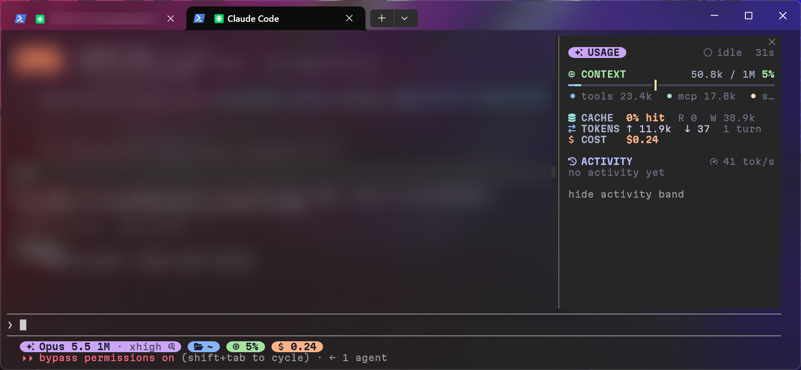

# capsule-panel

A live usage dashboard for Claude Code — context breakdown, cache hits, rate-limit forecast, cost and activity, in a Catppuccin capsule-style side pane.

English | [简体中文](README.zh-CN.md)



## What it shows

A side pane, one page, with each section hiding itself while it has nothing to say:

- **Header**: the model and effort in use, and whether Claude is working
- **CONTEXT**: how full the context window is, split by category, with a marker where auto-compact kicks in. Below it, how many turns are left before auto-compact at the recent rate of growth, and a **compact now** button while Claude is idle (press it twice within 3 seconds; after a compaction the line shows how far it shrank the context)
- **CACHE / TOKENS / COST**: prompt-cache hit rate and how long the cache stays warm (seconds in its last minute, then `cold`), tokens in and out, session cost and $/hour
- **SPEND**: what every Claude Code session on this machine has spent today and this week (from Monday), with a bar for each of the last seven days. It adds up the session cost Claude Code reports, an estimate at API prices, kept in the plugin's own store from 0.4.0 on
- **LIMITS**: each plan rate-limit window with its reset countdown, and a forecast of whether you'll hit it before it resets. Rate limits are only reported on a Claude subscription; without them this section hides and COST shows tokens per hour instead. When the forecast says a window will run out before its reset, a toast says so once per window
- **ACTIVITY**: a tok/s sparkline, the last five tool calls with their time and outcome, and running subagents
- **GIT**: branch, commits ahead/behind, lines added/removed, and the files Claude edited this session, newest five first with their lines changed (`new` for an untracked file). Outside a repository it still lists the edited files
- **TODO**: the current todo list's progress and the step under way
- **Footer**: the settings button, and the Claude Code and Claude Desktop versions

While Claude works, a new activity row lights up and fades within a second, and any figure at 80% or more (context, a rate limit) breathes red. Idle, the pane holds still.

Plus a one-line band above the prompt while Claude is working: a capsule naming the phase or the tool, what it is doing and for how long, then tok/s, running subagents and the turn's time. It takes no space when idle.

When a turn completes, a short tone plays where the platform has a player. When a turn that ran a minute or more completes, a notification says so: on Windows, a toast in the corner of the screen; elsewhere, Claude Code's own notification channel. Both are on in the terminal and off in Claude Desktop, which chimes and notifies by itself (see Settings).

## Requirements

- Claude Code 2.1.317 or later, in the terminal or in Claude Desktop
- In the terminal, a [Nerd Font](https://www.nerdfonts.com/) for the icons (developed with MartianMono Nerd Font in Windows Terminal). Without one, set Icons to `unicode` in the settings and the pane draws plain symbols instead
- Claude Desktop needs nothing: it draws the icons and capsules as vector shapes automatically

## Install

At the prompt of a Claude Code terminal session:

```
/plugin install capsule-panel --marketplace jsh135790/claude-code-capsule-panel
```

Answer `y` to add the marketplace, then press Enter to install for your user. It's active right away.

In Claude Desktop: click + next to the prompt box, then Plugins, add the marketplace `jsh135790/claude-code-capsule-panel`, then add the plugin.

## Usage

- In the terminal, the pane opens by itself when the window is at least 144 columns wide
- In Claude Desktop, the pane opens by itself when a conversation starts
- `/panel` opens or closes it at any width
- **settings** at the bottom of the pane opens its settings page; **← back** returns to the dashboard

## Settings

The settings page lists every option with a button that steps through its values. The terminal and Claude Desktop keep separate settings: a change applies to the surface you make it on. They are kept in the plugin's own store, not in `settings.json`, so a tool that rewrites `settings.json` (a provider switcher, say) leaves them alone.

| Setting | Values | Terminal | Claude Desktop |
| --- | --- | --- | --- |
| Activity band | on, off | on | on |
| Completion sound | on, off | on | off |
| Long-turn notification | on, off | on | off |
| after | 30s, 60s, 120s, 300s | 60s | 60s |
| Git & changed files | on, off | on | on |
| Cache countdown | on, off | on | on |
| TTL | auto, 5m, 1h | auto | auto |
| Today / week spend | on, off | on | on |
| Compact forecast | on, off | on | on |
| Versions | on, off | on | on |
| Icons (terminal only) | nerd, unicode | nerd | — |

- **Completion sound**: macOS plays it with `afplay`; a Windows or Linux terminal has no player and stays silent
- **TTL**: how long the prompt cache lasts. `auto` follows Claude Code's own rule: an hour on a Claude subscription, 5 minutes when an API key or token is set in the environment, or whatever `CLAUDE_CODE_PROMPT_CACHE_TTL` or the `promptCacheTtl` setting says
- **Icons**: Claude Desktop always draws vector icons

Before 0.4.0, `icons` and `sound` were set under `pluginConfigs` in `settings.json`. Those entries are now ignored and can be deleted.

## Optional: matching status line

`extras/statusline/statusline-command.sh` is a status line in the same capsule style: model and effort, directory, git branch, context %, cost and vim mode. It needs `bash` and `jq`; `git` is optional. It respects `NO_COLOR`.

Copy it to `~/.claude/statusline-command.sh` and add this to `~/.claude/settings.json`:

```json
"statusLine": {
  "type": "command",
  "command": "bash \"$HOME/.claude/statusline-command.sh\""
}
```

## Development

```
claude --plugin-dir /path/to/claude-code-capsule-panel
claude plugin validate .
claude plugin test .
npx -y -p typescript@5 tsc -p .
```

`tsconfig.json` extends `.claude-plugin/types/tsconfig.json`, which Claude Code writes the first time it loads the plugin, so run the plugin once before type-checking. The declarations it lays down are the build's own; type-check against a build that is 2.1.317 or later.

## License

[MIT](LICENSE)
