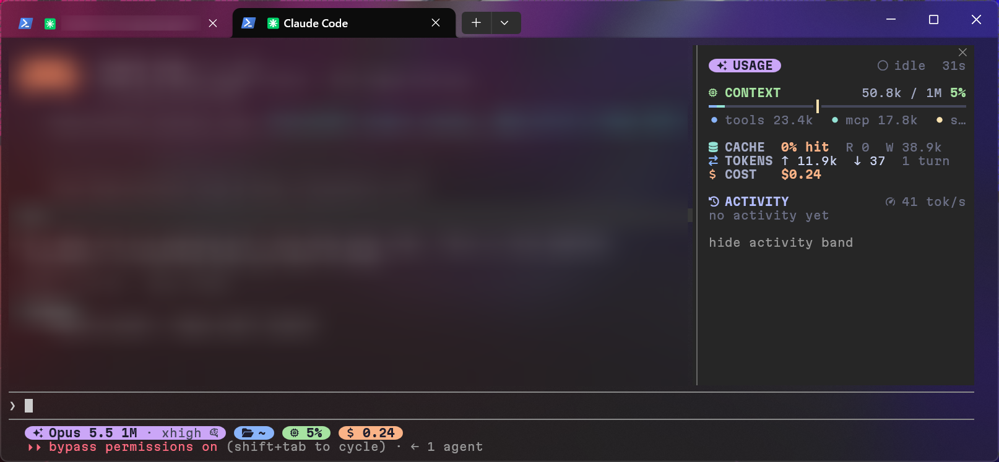

# capsule-panel

A live usage dashboard for Claude Code — context breakdown, cache hits, rate-limit forecast, cost and activity, in a Catppuccin capsule-style side pane.

English | [简体中文](README.zh-CN.md)



## What it shows

A side pane, one page, with each section hiding itself while it has nothing to say:

- **CONTEXT**: how full the context window is, split by category, with a marker where auto-compact kicks in
- **CACHE / TOKENS / COST**: prompt-cache hit rate, tokens in and out, session cost and $/hour
- **LIMITS**: each plan rate-limit window with its reset countdown, and a forecast of whether you'll hit it before it resets. Rate limits are only reported on a Claude subscription; without them this section hides and COST shows tokens per hour instead
- **ACTIVITY**: a tok/s sparkline, the last five tool calls with their time and outcome, and running subagents
- **GIT**: branch, commits ahead/behind, lines added/removed and changed files
- **TODO**: the current todo list's progress and the step under way

Plus a one-line band above the prompt while Claude is working: the current tool, elapsed time and tok/s. It takes no space when idle.

## Requirements

- Claude Code 2.1.293 or later (developed and tested on that build)
- A [Nerd Font](https://www.nerdfonts.com/) in your terminal for the icons (developed with MartianMono Nerd Font in Windows Terminal)

## Install

At the prompt of a Claude Code terminal session:

```
/plugin install capsule-panel --marketplace jsh135790/claude-code-capsule-panel
```

Answer `y` to add the marketplace, then press Enter to install for your user. It's active right away.

## Usage

- The pane opens by itself when the terminal is at least 144 columns wide
- `/panel` opens or closes it at any width
- The button in the pane hides or shows the band above the prompt

## Optional: matching status line

`extras/statusline/statusline-command.sh` is a status line in the same capsule style: model and effort, directory, git branch, context %, cost and vim mode. It needs `bash` and `jq`; `git` is optional. It respects `NO_COLOR`.

Copy it to `~/.claude/statusline-command.sh` and add this to `~/.claude/settings.json`:

```json
"statusLine": {
  "type": "command",
  "command": "bash \"$HOME/.claude/statusline-command.sh\""
}
```

## Development

```
claude --plugin-dir /path/to/claude-code-capsule-panel
claude plugin validate .
claude plugin test .
npx -y -p typescript@5 tsc -p .
```

`tsconfig.json` extends `.claude-plugin/types/tsconfig.json`, which Claude Code writes the first time it loads the plugin, so run the plugin once before type-checking.

## License

[MIT](LICENSE)
