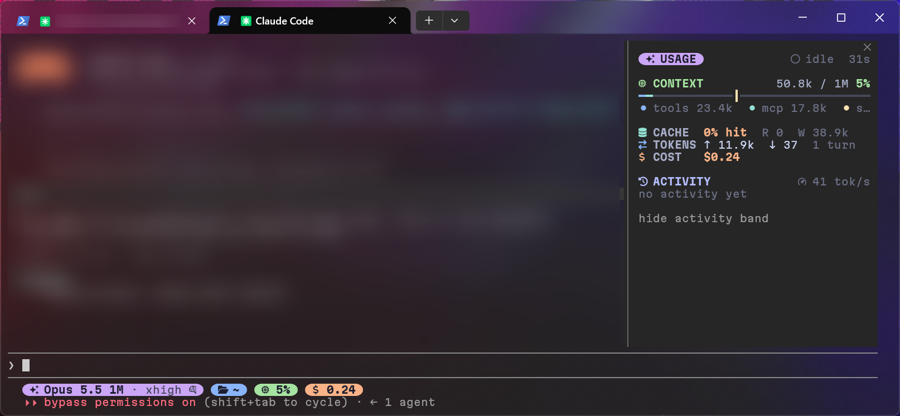

# capsule-panel

Claude Code 实时用量面板：上下文构成、缓存命中、限额预测、花费与活动，Catppuccin 胶囊风侧边栏。

[English](README.md) | 简体中文



## 面板内容

侧边栏只有一页，按区块排列，暂时没有数据的区块会自动隐藏。

- **CONTEXT**：上下文窗口占用，按类别分段显示，并标出自动压缩的触发位置
- **CACHE / TOKENS / COST**：提示缓存命中率、输入输出 token、本次会话花费和每小时花费
- **LIMITS**：每个限额窗口的重置倒计时，以及按当前消耗速度预测会不会在重置前用完。只有 Claude 订阅账号才会返回限额数据，没有的时候这一块隐藏，COST 改为显示每小时 token 数。预测到某个窗口会在重置前用完时，会弹一次 toast 提醒，每个窗口只提醒一次
- **ACTIVITY**：tok/s 火花线、最近 5 次工具调用（耗时和结果），以及正在运行的子代理
- **GIT**：当前分支、领先/落后的提交数、增删行数和改动文件数
- **TODO**：当前 todo 列表的进度和正在进行的步骤

Claude 工作时，输入框上方还会多出一行横幅：标明当前阶段或工具的胶囊、正在做什么和用了多久，右边是 tok/s、运行中的子代理和本轮用时。空闲时这一行不占位置。

每轮对话结束时会响一声短提示音（平台支持见下方「选项」）。

## 环境要求

- Claude Code 2.1.317 或更新版本，终端和 Claude Desktop 都能用
- 终端里建议使用 [Nerd Font](https://www.nerdfonts.com/) 字体显示图标（开发环境为 Windows Terminal + MartianMono Nerd Font）。没有的话把 `icons` 设成 `unicode`（见「选项」），面板会改用普通 Unicode 符号
- Claude Desktop 不需要任何设置，图标和胶囊会自动画成矢量图形

## 安装

在 Claude Code 终端会话的输入框里输入：

```
/plugin install capsule-panel --marketplace jsh135790/claude-code-capsule-panel
```

提示添加 marketplace 时输入 `y`，再按回车安装到用户范围，装完立即生效。

在 Claude Desktop 里：点输入框旁边的 +，进 Plugins，添加 marketplace `jsh135790/claude-code-capsule-panel`，再添加插件。

## 使用

- 在终端里，窗口宽度达到 144 列时面板会自动打开
- 在 Claude Desktop 里，开启对话后面板会自动打开
- 任何宽度下都可以用 `/panel` 打开或关闭面板
- 面板里的按钮可以隐藏或显示输入框上方的横幅

## 选项

在 `/config` 里找到插件名下的条目，或在 `~/.claude/settings.json` 的 `pluginConfigs` 里设置：

| 选项 | 取值 | 默认 | 作用 |
| --- | --- | --- | --- |
| `icons` | `auto`、`nerd`、`unicode` | `auto` | `auto` 在终端用 Nerd Font 图标、在 Claude Desktop 用矢量图标；`nerd` 处处强制用 Nerd Font，`unicode` 让终端改用普通符号 |
| `sound` | `true`、`false` | `true` | 每轮结束响一声短提示音。macOS 用 `afplay` 播放；Windows 和 Linux 终端没有播放器，不会出声；Claude Desktop 取决于应用本身 |

## 可选：同风格 statusline

`extras/statusline/statusline-command.sh` 是一个同样胶囊风格的状态栏，显示模型和 effort、目录、Git 分支、上下文百分比、花费和 vim 模式。依赖 `bash` 和 `jq`，`git` 可选，支持 `NO_COLOR`。

把它复制到 `~/.claude/statusline-command.sh`，再在 `~/.claude/settings.json` 里加上：

```json
"statusLine": {
  "type": "command",
  "command": "bash \"$HOME/.claude/statusline-command.sh\""
}
```

## 开发

```
claude --plugin-dir /path/to/claude-code-capsule-panel
claude plugin validate .
claude plugin test .
npx -y -p typescript@5 tsc -p .
```

`tsconfig.json` 继承自 `.claude-plugin/types/tsconfig.json`，这个文件要等 Claude Code 第一次加载插件时才会生成，所以做类型检查之前先把插件跑一次。生成的类型声明是那个版本自己的，请用 2.1.317 或更新的版本做类型检查。

## 许可证

[MIT](LICENSE)
